# Documento A — Arquitetura Geral do Sony PlayStation 1 (PS1 / PSone) e Matriz de Revisões

> **Convenção de Confiabilidade Epistêmica:**  
> - `[CONFIRMADO]`: explícito em fontes primárias inspecionadas (`psx-spx.consoledev.net`, `psdevwiki.com/ps1/*`, `consolemods.org/wiki/PS1:*`, esquemas/datasheets citados, guias oficiais `x-station/xstation-releases`, esquema `paulocode/picostation_pcb.kicad_sch` ou código-fonte `PicoStation-main`).  
> - `[CORROBORADO]`: convergência independente entre múltiplas fontes técnicas (ex.: `psx-spx` + `psdevwiki` + medidas/guias de campo).  
> - `[INFERIDO]`: dedução técnica direta a partir da evolução de família/pinagens/esquemáticos quando a revisão específica não traz tabela isolada.  
> - `[DESCONHECIDO]`: informação ausente ou não verificada nos documentos inspecionados (documentada também no `DOC_G`).

---

## 1. Visão Arquitetural Global e Evolução em 4 Gerações de CD-ROM

A arquitetura lógica do PlayStation 1 mantém o mesmo núcleo de processamento central de `PU-7` a `PM-41(2)`: uma CPU RISC MIPS R3000A (`LSI CW33300` + `COP0` + `COP2/GTE` + `MDEC` + controlador de DMA de 7 canais) comunicando-se com a `Main RAM` por um barramento exclusivo de 32 bits, com a `GPU` por um barramento paralelo `VBUS` de 32 bits, e com a `BIOS`, a `SPU`, o subsistema de `CD-ROM` e a porta de expansão (`PIO`) através do barramento de sistema `SBUS` de 16/8 bits `[CONFIRMADO]`.

O subsistema de vídeo/áudio e especialmente o **subsistema de CD-ROM** sofreram quatro grandes ondas de integração ao longo da vida do console (1994–2004), determinando onde um **ODE** como o `PicoStation` ou o `xStation` consegue interceptar os barramentos digitais I²S e subcódigo `[CONFIRMADO]`:

```mermaid
flowchart TD
    subgraph Core["Núcleo Principal (Todas as Revisões)"]
        CPU["IC103 CPU (CXD8530xQ / CXD8606xQ)<br/>MIPS R3000A 33.8688 MHz + GTE + MDEC + DMA"]
        RAM["Main RAM 2 MB<br/>(4x28p PU-7..PU-18-21 ou 1x70p PU-18-31+ / PSone)"]
        BIOS["IC102 BIOS ROM 512 KB (40p / 32p)<br/>(PU-16 VCD: 44p 1 MB)"]
        GPU["IC203 GPU (160p CXD8514Q ou 208p CXD8561xQ/CXD9500Q)"]
        VRAM["VRAM 1 MB<br/>(2x64p Dual-Port, 1x100p SGRAM ou On-Chip PM-41-61+)"]
        SIO["SIO0 (Controles / MemCard) & SIO1 (Serial Fat)<br/>CN103 PIO 68p (PU-7..PU-22)"]
        CPU <-->|"RAM Bus 32-bit"| RAM
        CPU <-->|"VBUS 32-bit + DMA2"| GPU
        GPU <--> VRAM
        CPU <-->|"SBUS 16/8-bit"| BIOS
        CPU <--> SIO
    end

    subgraph Gen1["Geração 1 CD: PU-7, PU-8, PU-16"]
        G1_RF["RF Amp + Servo<br/>IC702 CXA1782BR (48p)"]
        G1_DSP["CD DSP<br/>IC309 CXD2516Q (PU-7)<br/>CXD2510Q (PU-8/PU-16)"]
        G1_DEC["CD Decoder + FIFO<br/>IC305 CXD1199BQ / CXD1815Q"]
        G1_HC05["Mechacon IC304<br/>80p HC05L16 / 52p HC05G6<br/>Clock: X302 4.000 MHz"]
        G1_SPU["IC308 SPU CXD2922Q / CXD2925Q<br/>+ IC310 512KB + IC402 AK4309VM"]
        G1_RF --> G1_DSP -->|"DA15/16, LRCK, C2PO (PicoStation TAP)"| G1_DEC
        G1_HC05 <-->|"XLAT, CMD, SENS, SCOR, SQCK/SQSO"| G1_DSP
        G1_HC05 <--> G1_RF
        G1_DEC -->|"CD Audio / SBUS"| G1_SPU
    end

    subgraph Gen2["Geração 2 CD: PU-18"]
        G2_RF["RF Amp Dedicado<br/>IC703 CXA1791N (20p)"]
        G2_DSP["CD DSP + Servo<br/>IC701 CXD2545Q (100p)"]
        G2_DEC["CD Decoder + SRAM<br/>IC305 CXD1815Q + IC303"]
        G2_HC05["Mechacon IC304 (52p HC05G6)<br/>Clock 4.2336 MHz de IC701.68"]
        G2_SPU["IC308 SPU CXD2925Q + IC310"]
        G2_RF --> G2_DSP -->|"I2S / C2PO (8 pinos levantados)"| G2_DEC
        G2_HC05 <--> G2_DSP
    end

    subgraph Gen3["Geração 3 CD: PU-20"]
        G3_RF["RF Amp CXA2550N (20p)"]
        G3_COMBO["IC720 CXD1817R (144p)<br/>DSP + Servo + Decoder + SRAM 32KB on-chip"]
        G3_HC05["IC304 HC05G6 (4.2xxx MHz de IC720)"]
        G3_SPU["IC308 CXD2925Q + IC310"]
        G3_RF --> G3_COMBO <--> G3_HC05
    end

    subgraph Gen4["Geração 4 CD: PU-22, PU-23, PM-41, PM-41(2)"]
        G4_RF["IC723 CXA2575N-T4 (20p)<br/>RF Matrix (SCEx Data em SPU.42)"]
        G4_COMBO["IC732 CXD2938Q (208p)<br/>ou CXD2941R (176p PM-41(2) c/ SPU_RAM on-chip)<br/>DSP + Servo + Decoder + SPU + Audio DAC"]
        G4_HC05["IC304 HC05G6"]
        G4_RF --> G4_COMBO <--> G4_HC05
    end

    CPU <-->|"SBUS /CS5 + /IRQ2 + DREQ/DACK"| G1_DEC
    CPU <-->|"SBUS /CS5 + /IRQ2"| G2_DEC
    CPU <-->|"SBUS /CS5 + /IRQ2"| G3_COMBO
    CPU <-->|"SBUS /CD + /SPU + DMA4"| G4_COMBO
```

> **Impacto direto para o PicoStation / xStation:** Apenas as **Gerações 1 e 2** (`PU-7`, `EARLY-PU-8`, `LATE-PU-8` e `PU-18`; e com ressalvas/anomalias `PU-16`) mantêm o barramento físico externo entre o **CD DSP** e o **CD Decoder (`IC305 CXD1815Q` / `CXD1199BQ`)** exposto em pinos externos `[CONFIRMADO]`. A partir da **Geração 3 (`PU-20`)**, o `CXD1817R` funde DSP e Decoder internamente, inviabilizando ODEs baseados em injeção `DA15/DA16/LRCK/C2PO` sem substituir o barramento `SBUS` (abordagem de `PSIO` em `/CS5` + `/IRQ2`, ou emulação de sinal RF analógico tipo `ArcStation`) `[CORROBORADO]`.

---

## 2. Diferenças Estruturais: PlayStation Fat (PSX) vs. PS one

| Dimensão Arquitetural | PS1 Fat (`PU-7` a `PU-23`) | PS one (`PM-41` e `PM-41(2)`) | Status |
|---|---|---|---|
| **Fonte de Alimentação** | Fonte AC→DC interna modular via conector `CN602`: **7 pinos** (`PU-7..PU-16`, inclui `STAND-BY 3.54V`) ou **5 pinos** (`PU-18..PU-23`, sem pino standby) `[CONFIRMADO]`. | Fonte DC externa **+7.5V 2.0A** (ou **3.0A** `SCPH-120/121` p/ LCD, plugue pino central positivo `Ø 0.8mm` / externo `Ø 5.0mm`). Conversão on-board: `IC601` (`78M05`/`+5.0V`), `IC602` (`LP29851MX-3.5`/`+3.48V`), PWM `IC606/607` (`TL594CD`/`T594`) `[CONFIRMADO]`. | `[CONFIRMADO]` |
| **Geração de Reset (`/RES`)** | `IC101` (`M51957B`, 5 pinos) montado na **placa da fonte** interna `[CONFIRMADO]`. | On-board na placa-mãe: `IC002` (8p) ou `IC003` (5p + `Q004`), mais `Q002` `[CONFIRMADO]`. | `[CONFIRMADO]` |
| **Fusíveis (`PSnnn`)** | KOA `CCP2E15/20/50` (`PS601..PS605`) no secundário `+3.5V` e `+8V` `[CONFIRMADO]`. | `PM-41 -11`: 5× KOA 800mA no `+7.5V` (`PS602` protege Ctrl 3.5V na linha 8V). `PM-41 -21..-61`: adiciona `PS600` (2.5A) e funde 3.5V ctrl em `PS606`. `PM-41(2) -71/-81`: fusíveis SMD `1608` (`PS600` 2.0A, sem `PS603` separado) `[CONFIRMADO]`. | `[CONFIRMADO]` |
| **Porta Paralela (`CN103` PIO)** | Presente (68 pinos) de `PU-7` até `PU-22` (ocultada por carcaça em alguns `SCPH-9000` iniciais); **removida** em `PU-23` `[CONFIRMADO]`. | **Ausente** (sem trilhas nem conector) `[CONFIRMADO]`. | `[CONFIRMADO]` |
| **Porta Serial (`SIO1`)** | Conector de 8 pinos presente em **todas** as Fat (inclusive `PU-23`) `[CONFIRMADO]`. | Conector **removido**; restam apenas **6 pads de teste** abaixo dos pinos 52 e 100 da CPU na `PM-41` `[CONFIRMADO]`. | `[CONFIRMADO]` |
| **Saídas A/V** | `PU-7`: Multi-Out + RCA + **S-Video**. `PU-8`/`PU-16`: Multi-Out + RCA. `PU-18..PU-23`: **apenas AV Multi-Out** `[CONFIRMADO]`. | Apenas **AV Multi-Out** (`PM-41 1-679-335-21` possui saída RGB incompleta/com problemas vs `-51` completo) `[CONFIRMADO]`. | `[CONFIRMADO]` |
| **Portas de Controle (`SIO0`)** | Bloco encaixado; em `PU-23` conecta via placa filha/cabo plano `CN102` (10 pinos) `[CONFIRMADO]`. | Conectores de controle e Memory Card soldados diretamente na placa-mãe `[CONFIRMADO]`. | `[CONFIRMADO]` |
| **Osciladores e Clocks** | `PU-7..PU-18` (e conflito `PU-20`): dois osciladores de 4 pinos (`X101 67.737MHz` + `X201 53.20/53.69MHz`); `PU-7..PU-16` adicionam `X302 4.000MHz` p/ HC05. `PU-22/23`: cristal único `X201` + PLL `IC204` `[CONFIRMADO]`. | Cristal único de 2 pinos `X201` (`17.734MHz` PAL `4×Fsc` / `14.318MHz` NTSC `4×Fsc`) + `IC204` (`CY2081 SL-509/500` ou `2294A`) `[CONFIRMADO]`. | `[CONFIRMADO]` |
| **Firmware & Hardware Quirks** | BIOS sem cheque cruzado pesado nas `PU-7..PU-23` (exceto regiões `SCPH-xxx0`); bug de polling `HINTSTS` no controlador de CD ocorre em placas antigas como `LATE-PU-8`; `DRAM_CTRL` exige compatibilidade 4-bancos até `PU-8` `[CONFIRMADO]`. | `SCPH-102` (PAL PSone) possui checagem de região no BIOS que exige modchip com BIOS patch (ex. OneChip / PSNee); BIOS altera bit `14` / `DRAM` e amarra `/OE` da Main RAM ao `GND`; bug `HINTSTS` corrigido em silício `[CONFIRMADO]`. | `[CONFIRMADO]` |
| **Mecânica / Laser CD** | `KSM-440AAM` (plástico, desgaste próximo à fonte em `PU-7`/`PU-8`) → reposicionado para longe da fonte na `PU-18` + trilho fundido em metal + amortecedores `[CORROBORADO]`. | Drive compacto `KSM-440BAM`, ajuste 100% automático (zero potenciômetros na placa) `[CONFIRMADO]`. | `[CORROBORADO]` |

---

## 3. Matriz Completa de Revisões de Placa-Mãe do PlayStation 1

### 3.1 Tabela Geral de Placas, Modelos `SCPH`, Silício e ODE

| Revisão | PCB Part Number (Sony) | Ano & Modelos `SCPH` / `DTL` | Região / Clocks Base | CPU (`IC103`) | Main RAM (`IC106..109`) | GPU (`IC203`) & Memória de Vídeo | DAC / Encoder Vídeo | SPU (`IC308`/`IC732`) & Áudio | BIOS (`IC102`) | Mechacon (`IC304`) & ROM (`19h,20h`) | Chipset CD-ROM & Trimpots (`RV70x`) | Compatibilidade ODE (`PicoStation` / `xStation` / `PSIO`) |
|---|---|---|---|---|---|---|---|---|---|---|---|---|
| **PU-7** | `1-655-322-11`, `-13`, `-13A`, `-14`, `-14A`, `-15`, `-16` `[CONFIRMADO]` | Set 1994 – Nov 1995. `SCPH-1000`, início `1001`, muito início `3000/3500`, `DTL-H1000` (`-14`) `[CORROBORADO]` | `NTSC-J` (`vC0` só JP `[CONFIRMADO]`); `DTL` Multi. `X101 67.737` + `X201 53.xx` + `X302 4.000 MHz` `[CONFIRMADO]` | `CXD8530Q`, `CXD8530AQ`, `CXD8530BQ` (0.6µm metal→ASIC), `CXD8530CQ` (208p) `[CORROBORADO]` | **4× 28p** 512Kx8 (`[DESCONHECIDO]` part exato) `[CONFIRMADO]` | `CXD8514Q` (160p) + **2× 64p VRAM** (`uPD482445LGW-A70-S` ou `KM4216Y256G-60`) `[CONFIRMADO]` | `IC207 CXD2923AR` (64p) + `IC501 CXA1645M` (24p) `[CONFIRMADO]` | `IC308 CXD2922Q` (100p) + `IC402 AK4309VM` (`[CORR.]`) + `IC310` 40p (`3.5V` `[INF.]`) | **40p** 512Kx8 (`MX23L4100`, `/BYTE=GND`) `[CONFIRMADO]` | **80p** `MC68HC05L16` (`424666`, `424660`) `[CONFIRMADO]`; `DTL`: `MC68HC705L16CFU` (`D62P`). ROM: `vC0 (a/b)` (`94h,09h,19h,C0h` / `94h,11h,18h,C0h`) `[CONFIRMADO]` | `IC305 CXD1199BQ` (100p), `IC309 CXD2516Q` (100p!), `IC702 CXA1782BR` (48p), `IC704 BA6398FP` (28p), `IC303` 32KB, RF discreto, `IC701` 8p NC. Pots: `RV701, RV704, RV705` `[CONFIRMADO]` | `xStation`: **Sim** (levanta `CXD2516Q` `11,14,18,72`). `PicoStation`: **Não testado / não suportado oficial** (`tzmwx`; `CXD2516Q` diferente). `PSIO`: Sim `[CORR.]` |
| **EARLY PU-8** | `1-658-467-11`, `-12`, `-13` (`N4` em `-11`) `[CONFIRMADO]` | Nov 1995+. Primeiros `SCPH-1001/1002`, `3000/3500`, `DTL-H1102` (`-13`) `[CORROBORADO]` | NTSC-J / U / PAL. `X101 67.737` + `X201 53.20/53.69` + `X302 4.000 MHz` `[CONFIRMADO]` | `CXD8530CQ` (208p) `[CONFIRMADO]` | **4× 28p** `NEC 424805AL-A60` ou `SEC KM48V514BJ-6` `[CONFIRMADO]` | `CXD8514Q` (160p) + **2× 64p VRAM** (`uPD482445LGW-A70-S`) `[CONFIRMADO]` | `IC207 CXD2923AR` (64p) + `IC501 CXA1645M` (24p) `[CONFIRMADO]` | `IC308 CXD2922Q` / `CXD2922BQ` (100p) + `IC402 AK4309VM` + `IC405 NJM2100E` + `IC310 TC51V4260DJ-70` (`3.5V`) `[CORROBORADO]` | **40p** 512Kx8 (`SONY ...`) `[CONFIRMADO]` | **80p** `MC68HC05L16` (`424686`, `424659`, `424684`, `424694`) `[CONFIRMADO]`. ROM: `vC1` (`95-05-16` / `95-07-24`) `[CONFIRMADO]` | `IC305 CXD1815Q` (100p), `IC309 CXD2510Q` (80p), `IC702 CXA1782BR` (48p), `IC704 BA6398FP` (em `-11`), `IC303 HM62W256LFP-7T`, RF discreto, `IC701` 8p NC. Pots: `RV701, RV702, RV704` (`RV705` unpop) `[CONFIRMADO]` | `xStation`: **Sim** (QSB Early, `IC309` lift `44,63,66,69`, fios `APLL`+`IO35`). `PicoStation`: **Compatível c/ mapeamento PU-8** (atenção `X101` / OC e fios `APLL`/`IO35`) `[CORR.]` |
| **LATE PU-8** | `1-658-467-21`, `-22`, `-23`, `-41`, `-42` (+ `-43` DTL) `[CONFIRMADO]` | Fim 1995–1996+. Maioria `SCPH-1001/1002`, `3000/3500`, `5000`, `DTL-H1202` (`-43`), `DTL-H3001` (`-23` Yaroze) `[CORROBORADO]` | NTSC-J / U / PAL / Debug / Yaroze. `X101` + `X201` + `X302 4.000 MHz` `[CONFIRMADO]` | `CXD8530CQ` (`-21+`) até `CXD8606Q/AQ` (`psdevwiki/CPU` cita fim de vida `PU-8`) `[CORROBORADO]` | `-21..-23`: **4× 28p** (`KM48V514BJ-6` / `424805AL`). `-41/-42`: **1× 70p** (`psdevwiki/Motherboards`) `[CONFIRMADO]` | `CXD8561Q` (**208p**) + **1× 100p SGRAM** (`KM4132G271BQ-10`) `[CORROBORADO]` | `IC202` 44p `TDA8771H/AN` (JP/EU) ou `MC141685FT` (US/Asia) + `IC501 CXA1645M` `[CONFIRMADO]` | `IC308 CXD2925Q` (100p) + `IC402 AK4309VM` + `IC405 NJM2100E` + `IC310 TC51V4260DJ-70` (`3.5V`) `[CORROBORADO]` | **32p** 512Kx8 (`M534031C-25`, `SONY 2022` em `-23`) *(nota `-21` ainda em transição pré-`-22`)* `[CONFIRMADO]` | **52p** `MC68HC05G6` (`SC430911PB`, `16PB`, `17PB`, `18PB`, `20PB` D1, `26PB`/`27PB` Yaroze). ROM: `vC1 (a/b)`, `vD1`, `vC1 yaroze` `[CONFIRMADO]` | `IC305 CXD1815Q` (`CXD1815BQ` Yaroze), `IC309 CXD2510Q` (80p), `IC702 CXA1782BR` (48p), `IC722 BA6397FP` (28p), `IC303 HM62W256LFP-7T`. Pots: `RV701, RV702, RV704` `[CONFIRMADO]` | **Alvo Primário (`PU-8 OC/SCEI`).** `xStation` & `PicoStation`: **Sim** (`IC309` lift `44,63,66,69`, fio `IO16`, 3R bottom + R/L osc. top). `PSIO`: Sim `[CONFIRMADO]` |
| **PU-9** | `0-369-414-02` `[CONFIRMADO]` | Kiosk/Demo `NOT FOR SALE, SONY` (`DTL-H1201`) `[CONFIRMADO]` | Sem BIOS varejo (`[DESCONHECIDO]` clocks detalhados) | `[DESCONHECIDO]` | `[DESCONHECIDO]` | `[DESCONHECIDO]` | `[DESCONHECIDO]` | `[DESCONHECIDO]` | `[DESCONHECIDO]` | **80p** `MC68HC705L16CFU` (ROM interna / sticker `"7/24, 2.'E"`) `[CONFIRMADO]` | `[DESCONHECIDO]` (7-pin PSU confirmada) | `[DESCONHECIDO]` |
| **PU-16** | `1-665-191-11` + filha `MP-45 1-665-192-11` `[CONFIRMADO]` | 1996–1997. `SCPH-5903` (Ásia VCD, branco) `[CONFIRMADO]` | `NTSC-J` / Ásia. Main: `X101/X201/X302 4.000`; MP-45: `X103 45M`, `X104 12M`, `X105 28.636MHz` `[CONFIRMADO]` | `CXD8530CQ` `[CONFIRMADO]` (`psdevwiki/CPU`) | **4× 28p** (`[INFERIDO]` base Late PU-8) | `CXD8561BQ` (`psdevwiki/GPU`) + 100p SGRAM `[INFERIDO]` | `IC202 TDA8771H/AH` + `IC110` (MP-45) + `IC501 CXA1645M` + muxes `4053C`/`NJM2283` `[CONFIRMADO]` | `IC308 CXD2925Q` + mux áudio `4053C` `[CONFIRMADO]` | **44p 1MB** `M538032E-02` (`MSM538032E`) `[CONFIRMADO]` | **52p** `SC430924PB` (`C 4021`, `vC2 VCD` cmd `1Fh` Port F, `96-08-15`) `[CONFIRMADO]` | `IC305 CXD1815Q`, `IC309 CXD2510Q`, `BA6397FP`, + `MP-45` (`CXD1852AQ` MPEG-1, `CXP10224-603R`). Pots: `RV701, RV702, RV704` `[CONFIRMADO]` | `xStation`: Sim (`tzmwx`). `PicoStation`: **Anomalia relatada em `tzmwx` (incompatível na prática c/ firmware padrão)** `[CONFIRMADO]` |
| **PU-18** | `1-664-537-11`, `-21`, `-31`, `-41`, `-52`, `-62`, `-72`, `-82` `[CONFIRMADO]` | Mai 1997 – Abr 1998. `SCPH-5500/5501/5502/5503/5552`, raros início `700x/750x` `[CONFIRMADO]` | NTSC-J / U / PAL. `X101 67.737` + `X201 53.xx`; **SEM `X302`** (`IC304.14` recebe `4.2336 MHz` de `IC701.68 FSOF`) `[CONFIRMADO]` | `CXD8606Q` / `CXD8606AQ` (208p) `[CONFIRMADO]` | **`-11,-21,-52,-62`: 4× 28p**. **`-31,-41,-72,-82`: 1× 70p** (`K4Q153212M-JC60` / `T7X16`) `[CONFIRMADO]` | `CXD8561BQ` (208p) + 100p SGRAM (`KM4132G271BQ-10`) `[CORROBORADO]` | DAC integrado/ext. `[CORROBORADO]` + `CXA1645M` (`216:2922`, ver `DOC_G`) | `IC308 CXD2925Q` (100p) + `IC310` 40p (`[INFERIDO]`) | **32p** 512Kx8 (`SONY 2030`) `[CONFIRMADO]` | **52p** `MC68HC05G6` (`SC430925PB` `1030`, `29PB` `3030`, `30PB` `2030`). ROM: `vC2 (a.jap / a)` (`96-09-12`, `97-01-10`) `[CONFIRMADO]` | **`IC701 CXD2545Q`** (100p DSP+Servo), `IC305 CXD1815Q` (100p), `IC303 CXK5V8257BTM`, `IC703 CXA1791N` (20p RF), `BA6392FP` (28p). Pot único: **`RV703`** `[CONFIRMADO]` | **Próximo Alvo (`PU-18`).** `xStation` & `PicoStation`: **Sim** (`IC701` lift 8 pinos `45,46,47,56,74,77,78,80` + 1R bottom `APLL`). `PSIO`: Sim `[CONFIRMADO]` |
| **PU-20** | `1-668-413-12`, `-21`, `-22`, `-32`, `-42` `[CONFIRMADO]` | Abr – Ago 1998. Maioria `SCPH-700x`, `SCPH-7503` `[CONFIRMADO]` | NTSC / PAL. *Conflito `psx-spx`*: `X101+X201` vs cristal único + `IC204 CY2081 SL-500` `[CONFIRMADO]` | `CXD8606BQ` (208p) `[CONFIRMADO]` | `-12/-21`: 4× 28p. **`-22+`: 1× 70p** `[CONFIRMADO]` | `CXD8561AQ` / `BQ` / `CQ` (208p) + SGRAM `[CONFIRMADO]` | `IC502`: **`CXA2106R`** ou **`BH7240AKV`** (48p DAC+Encoder) `[CONFIRMADO]` | `IC308 CXD2925Q` (100p) `[CONFIRMADO]` | **32p** 512Kx8 `[INFERIDO]` | **52p** `MC68HC05G6` (`SC430934PB`, `SC430935PB`). ROM: `vC2 b` (`97-08-14`) `[CONFIRMADO]` | **`IC720 CXD1817R`** (144p DSP+Servo+Decoder+SRAM), `CXA2550N` (20p RF), `BA5977FP` (28p). Zero comp. no verso. Pot único: **`RV703`** `[CONFIRMADO]` | `PicoStation`/`xStation`: **Incompatível** (barramento DSP↔Decoder interno ao `CXD1817R`). `PSIO`: Sim `[CONFIRMADO]` |
| **PU-22** | `1-671-858-11`, `-12`, `-21`, `-22`, `-32` `[CONFIRMADO]` | Ago 1998 – Mai 1999. Final `SCPH-750x`, `9903`, início `900x` `[CONFIRMADO]` | NTSC / PAL. Cristal único `X201` (`17.734` PAL / `14.318` NTSC) + `IC204` (`CY2081`/`2294A`) `[CONFIRMADO]` | `CXD8606BQ` (208p) `[CONFIRMADO]` | **1× 70p** `[CORROBORADO]` | `CXD8561AQ` / `CQ` (208p) + 100p SGRAM `[CONFIRMADO]` | `IC502 CXA2106R-T4` / `BH7240AKV` `[CORROBORADO]` | **`IC732 CXD2938Q`** (208p, DAC integrado, s/ AK4309) + `IC405 NJM2100E` + `IC310` `5.0V` `[CONFIRMADO]` | **32p** 512Kx8 `[INFERIDO]` | **52p** `MC68HC05G6` (`SC430938PB`, `39PB`, `40PB`). ROM: `vC3 a` (`98-06-10`) `[CONFIRMADO]` | `IC732 CXD2938Q`, `IC723 CXA2575N-T4` (20p RF), `IC722 BA5977FP` / `AN8732SB`. **Sem potenciômetros** `[CONFIRMADO]` | `PicoStation`/`xStation`: **Incompatível**. `PSIO`: Sim (última c/ PIO `CN103`) `[CONFIRMADO]` |
| **PU-23** | `1-674-987-11`, `-21`, `-31`, `-41`, `-51` `[CONFIRMADO]` | Mai 1999 – Ago 2000. Final `SCPH-900x` (sem `CN103` PIO; ctrl via `CN102`) `[CONFIRMADO]` | NTSC / PAL. Cristal único `X201` + `IC204` `[CONFIRMADO]` | `CXD8606BQ` (208p) `[CONFIRMADO]` | **1× 70p** `[CORROBORADO]` | `CXD8561CQ` (208p) + 100p SGRAM 1MB `[CONFIRMADO]` | `IC502 CXA2106R-T4` / `BH7240AKV` `[CORROBORADO]` | `IC732 CXD2938Q` `[CONFIRMADO]` + `IC310`: em `-41`, **TSOP-II** `NN514256ALTT-50` `[CONFIRMADO]` | **32p** 512Kx8 `[INFERIDO]` | **52p** `MC68HC05G6` (`SC430942PB`, `44PB`). ROM: `vC3 b` (`99-02-01`) `[CONFIRMADO]` | `IC732 CXD2938Q`, `IC723 CXA2575N-T4`, `BA5977FP` / `AN8732SB`. Sem pots `[CONFIRMADO]` | `PicoStation`/`xStation`: **Incompatível**. `PSIO`: Solda direta extrema. `ArcStation`: Sim `[CORROBORADO]` |
| **PM-41** | `1-679-335-11`, `-21`, `-31`, `-41`, `-51`, `-61` `[CONFIRMADO]` | Jun 2000+. `SCPH-100/101/102/103` (PS one). Fonte ext. `7.5V` `[CONFIRMADO]` | NTSC / PAL. `X201` (`17.734`/`14.318`) + `IC204 CY2081 SL-509/500` ou `2294A` `[CONFIRMADO]` | `CXD8606BQ` / `CXD8606CQ` (208p) `[CONFIRMADO]` | **1× 70p** (`K4Q153212M-JC60` / `T7X16`; `/OE=GND`) `[CONFIRMADO]` | `-11..-51`: `CXD8561CQ` + `IC201 K4G163222A-PC70` (só 1MB). `-61`: **`CXD9500Q`** (SGRAM on-chip) `[CONFIRMADO]` | `IC502 CXA2106R-T4` (`-21` c/ RGB incompleto; `-51` OK) `[CONFIRMADO]` | `IC732 CXD2938Q` (208p) + `IC405 NJM2174` (14p) + `IC310 M11B416256A-35J` (SOJ `5.0V`) `[CONFIRMADO]` | **32p** `M534031E-47` / `M27V401D-41` (`Pin1=A19`) `[CONFIRMADO]` | **52p** `MC68HC05G6PB` (`SC430943PB`, `G63C 185`). ROM: `vC3 b` (`99-02-01`) `[CONFIRMADO]` | `IC732 CXD2938Q`, `IC723 CXA2575N-T4`, `IC722 BA5947FP` / `AN8732SB` (28p), `KSM-440BAM`. Sem pots `[CONFIRMADO]` | `PicoStation`/`xStation`: **Incompatível**. `ArcStation`: Sim `[CORROBORADO]` |
| **PM-41 (2)** | `-71` (`P-161125S-31-71`), `-81`, `-82` (`1-679-335-82`) `[CONFIRMADO]` | Até Dez 2004 (`"4D"`). `SCPH-100..103` tardios `[CONFIRMADO]` | NTSC / PAL. `X201` + `IC204` (`2294A`/etc.) `[CONFIRMADO]` | `CXD8606CQ` / último silício `[INFERIDO]` | **1× 70p** (`-82` muda p/ pacote IOP-RAM do PS2) `[CONFIRMADO]` | **`CXD9500Q`** (VRAM on-chip, sem `IC201`) `[CONFIRMADO]` | `IC502 CXA2106R-T4` `[INFERIDO]` | **`IC732 CXD2941R`** (176p, **SPU-RAM on-chip**, sem `IC310`) `[CONFIRMADO]` | **32p** `M534031E-47` `[CONFIRMADO]` | **52p** (`SC430947`, `48PB`, `49`, `52`). ROM: `vC3 c` (`A1-03-06`) `[CONFIRMADO]` | `IC732 CXD2941R`, `IC723 CXA2575N-T4`, `IC722 BA5947FP` / `AN8732SB`. Sem pots `[CONFIRMADO]` | `PicoStation`/`xStation`: **Incompatível**. `ArcStation`: Sim `[CORROBORADO]` |

### 3.2 Resolução de Conflitos e Ambiguidades nas Fontes Primárias

Durante a auditoria cruzada entre `psx-spx` e `psdevwiki`, quatro divergências foram identificadas e resolvidas com rigor:

1. **Main RAM da `PU-18` (4× 28 pinos vs. 1× 70 pinos):**
   - *Conflito:* `psx-spx` afirma numa seção que a `PU-18` introduziu `single 32bit Main RAM`, mas noutra tabela lista `IC106..IC109 (four 28pin chips, on PU-8, PU-18 boards)`.
   - *Resolução (`psdevwiki/Motherboards` `[CONFIRMADO]`):* Ambas estão parcialmente certas por **sub-revisão**! Na família `PU-18 (1-664-537-xx)`, as placas **`-11, -21, -52, -62`** mantêm **4 chips DRAM de 8 bits**, enquanto as **`-31, -41, -72, -82`** usam **1 único chip DRAM de 32 bits (70 pinos)**. Da mesma forma, na `LATE-PU-8`, **`-41/-42`** já migram para 1 único chip de RAM!

2. **Sistema de Clock da `PU-20` (`X101` vs. Cristal Único + `IC204`):**
   - *Conflito:* O resumo de clocks em `psx-spx` coloca `PU-20` ao lado de `PU-7..PU-18` (`67.737 MHz` + `53.20/53.69 MHz`), porém a seção de `IC204` escreve `"PSone, and PSX/PU-20 and up"` com `"single oscillator, and CY2081 SL-500 divider"`.
   - *Resolução parcial (`[CORROBORADO]` / `[DESCONHECIDO]`):* Sabe-se que `PU-20` e `PU-22` compartilharam a transição de encoder integrado (`CXA2106R` / `BH7240AKV`) e `PU-22+` usa `IC204` + cristal `17.734`/`14.318 MHz`. Fotos em alta resolução de uma `PU-20` (`1-668-413-xx`) são necessárias para confirmar se a transição do `IC204` começou na `PU-20` ou na `PU-22` (ver `DOC_G`).

3. **Typo "206-pin GPU" vs. 208 pinos reais no `psx-spx`:**
   - *Resolução (`[CONFIRMADO]`):* O título do capítulo em `psx-spx` grafa `"New 206-pin GPU"`, porém a tabela subsequente e o resumo enumeram exatamente **208 pinos** (`CXD8561xQ` / `CXD9500Q`). Além disso, a observação de cor de `psx-spx` cita `"GPU pin 154"`, enquanto a tabela correta coloca `FSC` no **pino 153** e `VDD` no **pino 154**.

4. **Diferenças `EARLY-PU-8` (`-11/-12/-13`) vs. `LATE-PU-8` (`-21/-22/-23/-41/-42`) críticas para `PicoStation`:**
   - Identificação visual rápida sem remover blindagem de todos os CIs (`[CONFIRMADO]` via `x-station` wiki + `PsNee` + `psdevwiki`):
     1. **Código impresso na placa:** `1-658-467-11/-12/-13` = **EARLY**; `1-658-467-21/-22/-23/-41/-42` = **LATE**.
     2. **Área de GPU/VRAM (face superior):** 2 chips VRAM 64p + `IC207` (`CXD2923AR`) + GPU 160p (`CXD8514Q`) = **EARLY**; 1 chip SGRAM 100p + DAC RGB 44p (`TDA8771H`/`MC141685FT`) + GPU 208p (`CXD8561Q`) = **LATE**.
     3. **Mechacon `IC304`:** Retângulo/quadrado maior de **80 pinos** (`MC68HC05L16`, `4246xx`) = **EARLY**; encapsulamento menor quadrado **52 pinos** (`MC68HC05G6`, `SC4309xx`) = **LATE**.
     4. **BIOS `IC102`:** 40 pinos (`EARLY` e talvez transição `-21`) vs. 32 pinos (`-22` em diante).

---

## 4. Versões de Firmware do Mechacon (`IC304` — HC05 Mask ROM) `[CONFIRMADO]`

Consultável em consoles ligados via comando **`19h, 20h`** (`INT3(yy, mm, dd, ver)`), e regiões via **`19h, 22h`** (a partir de `vC1+`):

| Sub-CPU / Encapsulamento | Código Impresso / Máscara | CRC32 (Dump) | `19h,20h` (`yy-mm-dd, ver`) | `19h,22h` String / Notas | Placa / Modelo Associado |
|---|---|---|---|---|---|
| Sony `CXP82300` (SPC700 80p) | Piggyback `27C256A-15` EPROM | — | `94-11-28, 01h` (debug) | `v01` debug | `DTL-H2000` (dev kit PCI) |
| `MC68HC05L16` (80p) | `Sony E35D, 424666 185, SSAD9441D` | `60BC954E` | `94-09-19, C0h` (`vC0 a`) | `INT5(11h,10h)` (só JP `"SCEI"`) | `SCPH-1000` JP (`PU-7 1-655-322-11`) |
| `MC68HC05L16` (80p) | `Sony E35D, 424660 185, SSAK9502A` | `F82A2A46` | `94-11-18, C0h` (`vC0 b`) | Só JP `"SCEI"` | `SCPH-1000/3000` JP (`PU-7 -13/-15`) |
| `MC68HC705L16CFU` (80p) | `D62P SSAW9601A` | — | `(DTL)` | Region-free / CD-R | `DTL-H1000` (`PU-7 -14`), `PU-9` (`"7/24, 2.'E"`) |
| `MC68HC05L16` (80p) | `424686` (`SSBP9539B`) | `BB134697` | `95-05-16, C1h` (`vC1 a`) | `"for Europe"` (`SCEE`) | `SCPH-1002` PAL (`EARLY-PU-8 -11`) |
| `MC68HC05L16` (80p) | `424659` (`SSAC9539A`) | `426C05E7` | `95-07-24, C1h` (`vC1 b`) | `"for U/C"` (`SCEA`) | `SCPH-1001` US (`EARLY-PU-8 -11`) |
| `MC68HC05L16` (80p) | `424684` (`SSAM9542B`) | `84D46B2A` | `95-07-24, C1h` (`vC1 b`) | `"for Europe"` (`SCEE`) | `SCPH-1002` PAL (`EARLY-PU-8 -11`) |
| `MC68HC05G6` (52p) | `C 1021 SC430916PB` | `A730082B` | `95-07-24, C1h` (`vC1 b`) | `"for Japan"` (`SCEI`) | `SCPH-5000` JP (`LATE-PU-8 -42`) |
| `MC68HC05G6` (52p) | `C 3021 SC430917PB` | `96A79014` | `95-07-24, C1h` (`vC1 b`) | `"for Europe"` (`SCEE`) | `SCPH-1002` PAL (`LATE-PU-8 -22`) |
| `MC68HC05G6` (52p) | `C 2021 SC430918PB` | `1617EC6A` | `95-07-24, C1h` (`vC1 b`) | `"for U/C"` (`SCEA`) | `SCPH-1001` US (`LATE-PU-8 -23`) |
| `MC68HC05G6` (52p) | `D 2021 SC430920PB` | `7455BB05` | `95-07-24, D1h` (`vD1` debug) | `"for US/AEP"` (region-free + CD-R) | `DTL-H1202` (`LATE-PU-8 -43`), `DTL-H2500` |
| `MC68HC05G6` (52p) | `W2021 SC430926PB` / `W3021 27PB` | `DF333241` | `96-08-18, C1h` (`vC1` Yaroze) | `"for NETNA"` (`SCEI/E/A/W`) | `DTL-H3001/3002` Yaroze (`LATE-PU-8 -23`) |
| `MC68HC05G6` (52p) | `C 4021 SC430924PB` | `AB3E59EB` | `96-08-15, C2h` (`vC2 VCD`) | Cmd `1Fh` Port F (código ~`vC1`) | `SCPH-5903` VCD (`PU-16 -11` + `MP-45`) |
| `MC68HC05G6` (52p) | `C 1030 SC430925PB` | `A627277A` | `96-09-12, C2h` (`vC2 a.jap`) | `"for Japan"` (`SCEI`) | `SCPH-5500` JP (`PU-18 -11`) |
| `MC68HC05G6` (52p) | `C 3030 SC430929PB` / `2030 30PB` | `BA87A3E0` / `2A93140F` | `97-01-10, C2h` (`vC2 a`) | `"for Europe"` / `"for U/C"` | `SCPH-5502` / `5501` (`PU-18 -62`) |
| `MC68HC05G6` (52p) | `C 1040 SC430934PB` / `3040 35PB` | `F38341C4` / `33899F2A` | `97-08-14, C2h` (`vC2 b`) | JP / PAL | `SCPH-7000/7002` (`PU-20 -22/-32`) |
| `MC68HC05G6` (52p) | `C 1050 38PB` / `3050 39PB` / `2050 40PB` | `191772D1` / `9EAFB045` / `184D34B6` | `98-06-10, C3h` (`vC3 a`) | JP / PAL / US | `SCPH-7500/7502/7501` (`PU-22 -11/-32`) |
| `MC68HC05G6` (52p) | `C 1060 42PB` / `3060 43PB` / `2060 44PB` | `7F90B681` / `2669A1A7` / `BD117489` | `99-02-01, C3h` (`vC3 b`) | JP / PAL / US | `PU-23` (`-11`) & `PM-41` (`-51`) |
| `MC68HC05G6` (52p) | `C 3070 SC430948PB` (+ `47/49/52`) | `0E8AD915` | `A1-03-06, C3h` (`vC3 c`) | 06 Jun 2001 | `PM-41(2)` (`-71/-82`) |

*(Nota sobre `SCEx`: Apesar de `GetID`/comandos em `PU-8`/`PU-18` dependerem do firmware do Mechacon acima, **não é a imagem do disco** que determina qual string `SCEx` o PicoStation deve enviar — quem valida o `SCEx` é o **HC05 do console** `[CONFIRMADO]`, razão pela qual um console `SCEI` japonês precisa receber `"SCEI"` do modchip/PicoStation, além de exigir BIOS patch ou boot loader para rodar jogos de outra região sem trava de BIOS `[CONFIRMADO]`.)*
