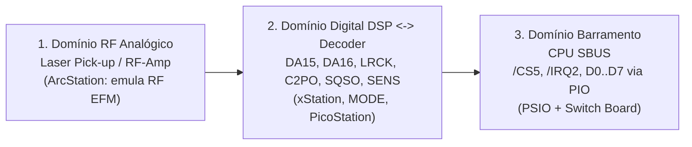

# Documento E — Projetos de Engenharia Reversa, Modchips, ODEs e Periféricos do Ecossistema PS1

> Levantamento técnico comparativo fundamentado em `psdevwiki.com/ps1/*`, `psx-spx.consoledev.net`, `consolemods.org/wiki/PS1:*`, `github.com/x-station`, `github.com/paulocode/picostation`, `github.com/megavolt85/picostation`, `github.com/tzmwx/PICOSTATION-PU8-PU18`, `github.com/kalymos/PsNee`, `github.com/postal2201/PSNee_V8`, `github.com/dangiu/PicoMemcard`, `github.com/darthcloud/BlueRetro`, `github.com/brad-lin/FreePSXBoot` e auditoria local de `PicoStation-main`.

---

## 1. Taxonomia de Modchips (Bypass de Wobble `SCEx` e Patch de BIOS) `[CORROBORADO]`

Modchips tradicionais mantêm o drive óptico original e apenas sintetizam o sinal digital de autenticação `"SCEA"`/`"SCEE"`/`"SCEI"` (250 bps) e/ou realizam *patch* em tempo de execução no barramento da Boot ROM:

| Projeto | Hardware Base | Revisões Compatíveis | Sinais / Pontos Principais | Stealth / Mecanismo Técnico | Limitações / Observações |
|---|---|---|---|---|---|
| **Old Crow** (1997) | `Z8` / `PIC16C54/84` / `PIC12C508` (4 fios) | `PU-7..PM-41` *(parcial em BIOS travadas)* | `VCC`, `GND`, `DATA (SCEx)`, `GATE` (`PU-7/8`) | Injeção cega contínua de `SCEx`; sem `DOOR`/`SQCK` | **Sem stealth**: detectado por jogos anti-modchip (`19h,04h/05h`); em discos originais precisa aterrar `GATE` ou pode colidir `[CONFIRMADO]`. |
| **Mayumi v4** | `PIC12C508` / `509` / `12F629` | **`PU-18` em diante** (**incompatível com `PU-7`/`PU-8`**) | `VCC`, `GND`, `DATA`, `XLAT`, **`CLK` (`4.23 MHz` MechaCon)**, `DOOR`/`WFCK` | Usa clock do HC05 (zero deriva de oscilador RC) e monitora `XLAT` para silenciar `SCEx` pós-boot `[CONFIRMADO]` | Requer dois perfis de tempo para `PU-18/20`; não funciona em `PU-7/8` pois o clock de `X302` é `4.000 MHz` `[CONFIRMADO]`. |
| **MM3** | `PIC12F629` / `12C508` | **`PU-7`..`PM-41`** (stealth parcial em `PU-7/8`) | `VCC`, `GND`, `DATA`, `GATE`/`WFCK`, `DOOR`, `RESET` | Port do Mayumi v4 usando **oscilador interno do PIC** (dispensa fio de clock HC05; opção 4 fios non-stealth) `[CONFIRMADO]` | Menor precisão de baud que clock externo; em `PU-7/8` stealth não é 100% imune a variações térmicas `[CORROBORADO]`. |
| **OneChip** | `PIC12C508` / `12F629` | Exclusivo **PAL PSone (`SCPH-102`)** | `DATA`, `WFCK`, **`BIOS D2/A18` (patch ROM)** | Base MM3 + *on-the-fly BIOS patch* (força bit na leitura da Boot ROM p/ liberar jogos JP/US) `[CONFIRMADO]` | Sem troca de modo por Reset (PSone não tem fio dedicado como Fat); requer DFO/NTSC-fix p/ cor em TVs PAL `[CONFIRMADO]`. |
| **PsNee (`v7`/`v8`)** | `ATtiny25/45/85` *(sem BIOS patch)*, **`ATmega328/168/32U4`**, `CH32V003`, `RP2040` (`kalymos` / `postal2201`) | **`PU-7`..`PM-41(2)`** *(universal)* | `VCC`, `GND`, `DATA`, `GATE`/`WFCK`, **`SQCK` + `SUBQ`**, e opcionais **`BIOS Ax/Dx` + `RESET`** (8–10 fios) | **Stealth 100% em `PU-7/PU-8`**: decodifica **SubQ em tempo real** via `SQCK`/`SQSO` e injeta `SCEx` somente na zona de boot; **coloca todos I/Os em Hi-Z** fora da injeção (evita ruído de RF no `PM-41(2)`) `[CONFIRMADO]` | `ATmega328` requer `BOD = 2.7V` e prog. **ISP** sem bootloader p/ timing estrito do BIOS patch (`H:DF, L:EE/FF` em `PSNee_V8`) `[CONFIRMADO]`. |
| **Chipless (`psx-spx`)** | 0 CIs (2 diodos + jumper na PCB) | Protótipo / apenas `PU-22+` (`[CORR.]`) | `SCEx` / `GND` / pull manual `[CORROBORADO]` | Apenas menção histórica de boot manual / pin-bridging | Não suporta stealth nem jogos anti-modchip de forma automática. |

---

## 2. Comparação Arquitetural dos ODEs de PS1 (`xStation`, `PSIO`, `MODE`, `ArcStation`, `PicoStation`) `[CORROBORADO]`

Existem **três fronteiras elétricas possíveis** na cadeia de CD-ROM do PS1 para interceptar e emular o disco:

| Projeto ODE | Arquitetura / MCU / FPGA | Fronteira Interceptada | Modelos / Placas Suportados | Retém Drive Físico? | Soldagem Exigida | Prós / Contras & Particularidades Documentadas |
|---|---|---|---|---|---|---|
| **xStation** (`@ramapcsx2`) | **ESP32 (WROOM-32)** + lógica auxiliar | Fronteira **2 (DSP ↔ Decoder)**: I²S + SubQ + SENS + `SCEx` | `PU-7`, `EARLY-PU-8`, `LATE-PU-8`, `PU-16` (`tzmwx`), **`PU-18`** | Não | QSB + lift **4 pinos** (`PU-7/8`) ou **8 pinos** (`PU-18`) + remov. passivos + fio `APLL`/`IO` | Usa o `CXD1815Q` e `MC68HC05` originais da Sony -> altíssima fidelidade de hardware (`DMA3`, timing HC05 real), sem DRM; limitado às placas com barramento DSP externo exposto `[CONFIRMADO]`. |
| **PicoStation** (`paulocode` / `megavolt85` / nosso fork) | **Raspberry Pi Pico (`RP2040` / `RP2350` + PIO/PWM/DMA)** | Fronteira **2 (DSP ↔ Decoder)** — mesmo ecossistema QSB 20p do xStation! | `EARLY-PU-8`, `LATE-PU-8`, **`PU-18`** *(incompatível prática na `PU-16` segundo `tzmwx`)* | Não | Idem xStation (`QSB + FFC 20p`) ou fly-wire (`tzmwx`); em `RC5` também usa `GPIO 3` p/ clock HC05 | Custo baixíssimo, código aberto (Apache 2.0 no ramo `src/`; `RC5` tem blobs fechados em `releases/RC5/`); compatibilidade em amadurecimento; requer **exFAT** (megavolt85) + atenção ao **desvio `+0.092%` (`67.8 MHz`)** e **tensão `3.3V` RP2040** `[CONFIRMADO]`. |
| **MODE** (`Terraonion`) | FPGA / SoC | Fronteira **2 (DSP ↔ Decoder)** | `PU-7`, `PU-8`, `PU-18` (mesma família QSB xStation) | Não | Idem xStation | Suporta HDD SATA/SD; caro, firmware proprietário c/ DRM e bug histórico de glitches em áudio CD-DA no PS1 (`consolemods`) `[CONFIRMADO]`. |
| **PSIO** (`Cybdyn`) | FPGA + ARM no cartucho PIO + Switch Board | Fronteira **3 (`SBUS /CS5, /IRQ2`)** | **`PU-7`..`PU-22`** oficial (`PU-23`/PSone c/ solda pesada) | **Sim** (permite alternar CD real vs SD) | Instalação da Switch Board na `CN103` PIO + corte de 3 trilhas (`/CS5`, `/IRQ2`, `SBEN`) | Não depende do `CXD1815Q` externo (emula controlador inteiro + HC05); sofre incompatibilidades em jogos sensíveis ao hardware real (ex. `Vib Ribbon`), firmware com DRM e ocupa a porta PIO `[CONFIRMADO]`. |
| **ArcStation** | FPGA / DAC de alta velocidade | Fronteira **1 (Pickup RF / EFM analógico)** | **Todas (`PU-7` até `PM-41(2)`)** | Não (plug-and-play no lugar do bloco laser) | **Zero solda** (plug no conector `CN701/CN702` + fita FFC) | Único ODE sem solda e compatível com `PU-20..PM-41(2)`; suporta VMC em Fat; caro e baixa disponibilidade `[CORROBORADO]`. |

### Evolução Específica dos Ramos PicoStation (`[CONFIRMADO]` via repos locais e GitHub)
1. **`paulocode/picostation` (2022–2024, arquivado em C):** prova de conceito em C puro com 1 imagem fixa `UNIROM.bin/.cue`, instável em multi-track, sem `SCEx` confiável inicialmente (patch posterior de `OldBoredEE`), dependia de `picostation_pcb` (`LM78M05` + `1N5819`).
2. **`megavolt85/picostation` (2025+, C++, foco em estabilidade & exFAT):** reescreveu a base em C++ com parser CUE do `PCSX-Redux`, driver SD-SPI `carlk3` a `30 MHz`, menu loader (`DirectoryListing`), **cache de 32 setores em SRAM**, funções críticas na SRAM (`__time_critical_func`), e liberou binários `RC5` fechados (`PU8`, `PU18`, `PU8_OC`, `PU18_OC`, variantes `_SCEA`/`_SCEE`/`_SCEI` e `_fast`). Conforme descobrimos no `DOC_F`, o `RC5` introduziu PWM em `GPIO 3` (clock HC05 `3.988 MHz`/`4.238 MHz`), `UART1` em `GPIO 4` (258.6 bps 8N1->patch 8N2) e modo OC dinâmico (`6.46 MHz`/`7.53 MHz`), mas trouxe um bug de zona (`sectorMax=333000 -> cur_zone=14`).
3. **`tzmwx/PICOSTATION-PU8-PU18`:** documenta instalação por **fiação direta (*fly-wire*) sem QSB**, válida para `PU-8` e `PU-18`, recomendando ligar `DOOR` para simular tampa fechada em testes e relatando falha na `PU-16 SCPH-5903`.
4. **Fork Local Auditado (`PicoStation-main`):** combina a base C++ com patches críticos descritos em `HANDOFF.md` e `docs/source-changes.patch`: SubQ CRC-16 CCITT opcional (`PICOSTATION_SUBQ_CRC`), bit-bang exato de `SCEx` a **250.0 bps 8N2** invertido, histerese `17`, e correções de estado/zoneamento de busca em `drive_mechanics.cpp`/`cmd.cpp` (detalhado no `DOC_F`).

---

## 3. Outros Projetos Relevantes de Engenharia Reversa (`[CONFIRMADO]` / `[CORROBORADO]`)

- **Memory Cards Open-Source & Exploits (`PicoMemcard`, `MemCard Pro`, `FreePSXBoot`, `tonyhax`, `UniROM`):**
  - **`PicoMemcard` / `PicoMemcard+` (`dangiu`):** Usa um RP2040 com PIO no barramento SPI `SIO0` (`~250 kHz`, pinos `1,2,4,5,6,7,9`, omitindo `3=+7.5V` e `8=/IRQ10`), **aviso crítico**: nunca conectar o Pico ao USB enquanto conectado ao PS1 sem isolamento/diodo para não destruir o barramento de `3.5V` do PS1 ou o regulador! Armazena blocos de 128 KB na Flash interna ou MicroSD (`PicoMemcard+`) e implementa troca virtual de cartões.
  - **`MemCard Pro` / protocolo `GameID` (`0x81`, subcomando `0x20`/`0x21`):** ODEs (`xStation`, `PSIO`, futuras extensões PicoStation) enviam o **Game ID (ex. `SLUS_00123`)** pelo barramento `SIO0` usando o comando proprietário **`0x21`** para seleção automática de cartão virtual; o protocolo `FreePSXBoot` explora falha de validação de índice de slot/filesystem no manipulador de Memory Card da BIOS (sem checagem de limites no registrador/stack) para executar código arbitrário diretamente do slot de Memory Card sem modchip `[CORROBORADO]`.
  - **`tonyhax` / `tonyhax international`:** Exploits de savegame + *Secret Unlock* (`50h..56h` nas BIOS/HC05 `vC1+` não-japonesas) + *CD swap* para derrotar proteção sem hardware extra.
- **Adaptadores de Controle (`BlueRetro` — `darthcloud`, `BlueMemCard` — `ChrispyNugget`):**
  - Implementado em **ESP32** (`SPI/GPIO` de baixa latência emulando protocolo `SIO0` LSB-first `0x01`/`0x42`/`0x43`, DualShock `5A73h`, Mouse `5A12h`, Multitap `5A80h`) para até 4 controles Bluetooth simultâneos; `BlueMemCard` unifica `BlueRetro` + `PicoMemcard` em um módulo PCB interno/cartucho.
- **Captura Digital HDMI & Áudio S/PDIF (`PS1Digital` / `RetroGEM`, `Pep Audio 1.2`):**
  - **`PS1Digital` (`black-dog.tech` / `RetroGEM`):** Compatível especificamente com **`PU-18` e `PU-20`** (`CXD8561xQ` 208p) — intercepta diretamente os 24 bits RGB digitais (`DAC.R0..7, G0..7, B0..7`, pinos `160..189`), `PCK` (`199`), `/HSYNC` (`159`), `/VSYNC` (`158`), áudio I²S + **`PSNee` e `IGR` (In-Game Reset) integrados** em um flex PCB soldado sobre GPU/DAC `[CONFIRMADO]`.
  - **`S/PDIF Mod` (`Pep Audio 1.2` / `TheRetroChannel PIO Adapter`):** Captura `DATA`, `BCK (BCLK)`, `LRCK`, `MCLK` (da SPU/DAC `IC402` ou dos pinos `32/33/66/67` da porta paralela `CN103` em `PU-7..PU-20`) e converte para fluxo óptico TOSLINK (`TX178A`) alimentado a `+5V` `[CONFIRMADO]`.
- **Mod de Overclocking de CPU (`ConsoleMods`):** Substitui o clock de `67.7376 MHz` (`CPU = 33.8688 MHz`) na entrada **`IC103.4` (`CRYSTALP`, pino levantado)** por um oscilador 4 pinos ex. `80 MHz` (`CPU = 40 MHz`, mantendo separação ou cuidado com divisão `÷0x600` do áudio e clock de CD quando `X101` é removido!) `[CONFIRMADO]`.
